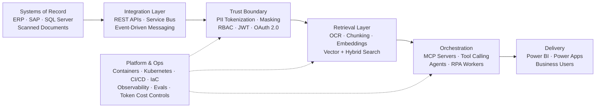

<!--
  ============================================================
  SAZZAD HOSSAIN TASNIM — GitHub Profile README
  Repo: github.com/SAZZAD-HT/SAZZAD-HT
  ------------------------------------------------------------
  WHAT THIS FILE DOES AND DOES NOT DO FOR SEARCH:

  DOES:
  - The text below sits in the HTML of github.com/SAZZAD-HT and
    is crawlable. Name, employers, titles and technologies all
    appear as real prose, not only inside badge images.
  - github.com has high domain authority, so this page should
    rank for searches on the exact name.

  DOES NOT:
  - It does NOT control the page title or meta description.
    Google reads the GitHub BIO FIELD as the meta description,
    not this README. The bio is the highest-leverage 160
    characters available — edit it in profile settings.
  - Links here are rendered rel="nofollow" by GitHub, so they
    pass no ranking credit to LinkedIn / Scholar / X.
  - The Mermaid diagram renders client-side. It is excellent
    for human readers and worth roughly nothing for search.
  - Badge alt text is good accessibility practice and near-zero
    ranking value. Do not add badges for SEO reasons.

  For real SEO control (title, meta description, Person JSON-LD
  with sameAs, canonical, sitemap), publish a GitHub Pages site
  and link it from the profile.
  ------------------------------------------------------------
  BEFORE YOU PUBLISH:
  Delete any badge for a tool you have not actually used, and
  move it to "Currently Expanding Into" if you are learning it.
  A stack you cannot defend in an interview costs more than the
  keywords earn, and search engines discount stuffed pages.
  ============================================================
-->

# Sazzad Hossain Tasnim

### AI &amp; ERP Modernization Engineer · .NET · Microservices · MCP &amp; LLM Orchestration · Azure DevOps

---

## About Me

I'm **Sazzad Hossain Tasnim**, a **Software Engineer based in Dhaka, Bangladesh** with **3+ years**
of experience modernising enterprise systems for global manufacturing and FMCG organisations —
currently **Software Engineer L2 at American &amp; Efird**, previously at **British American Tobacco**,
**Ha-Meem Group** and **iBOS Limited**.

My specialty is **AI-driven ERP modernization**: taking the systems of record a business already
runs on — ERP, SAP, SQL Server, decades of scanned paperwork — and wrapping them in **retrieval,
agents and automation** without ripping them out. That means **C# and ASP.NET Core** services built
on **Clean Architecture and CQRS**, **microservices on Microsoft Azure**, **MCP servers and LLM
orchestration** over enterprise data, **PII tokenization** at the trust boundary, and the **DevOps
and LLMOps** plumbing that keeps it observable, affordable and safe in production.

- 🏢 **Software Engineer L2** at **[American &amp; Efird](https://www.amefird.com/)** — ERP automation, multilingual OCR, Azure microservices
- 🤖 Building **Model Context Protocol (MCP) servers** and agentic workflows over enterprise ERP data
- 🔐 Focused on **data tokenization, PII masking and RBAC** as the trust boundary between ERP and LLMs
- ⚙️ Shipping with **containers, CI/CD, infrastructure as code and LLM observability**
- 🎓 **BSc in Computer Science**, American International University-Bangladesh (AIUB)
- 💬 Ask me about **ERP modernization, CQRS, MCP, RAG, token cost control, Azure**
- 📫 Reach me at **[sazzadaiub1@gmail.com](mailto:sazzadaiub1@gmail.com)**

---

## What I Build — AI × ERP Modernization

Most enterprises don't need a new ERP. They need the one they have to become **queryable,
automatable and safe to expose to a language model**. This is the reference architecture I work in:

**How the layers break down**

| Layer | What it solves | What I use |
| :--- | :--- | :--- |
| **Systems of record** | Legacy ERP and paper processes that hold the real business data | SAP · SQL Server · ERP modules · Tesseract OCR |
| **Integration** | Decoupling AI features from the monolith so nothing gets rewritten | ASP.NET Core · REST · Service Bus · strangler-fig migration |
| **Tokenization &amp; trust** | Making enterprise data safe to send to a model | PII tokenization · masking · RBAC · JWT · OAuth 2.0 · Key Vault |
| **Retrieval** | Turning documents and tables into something a model can ground on | Chunking · embeddings · vector + hybrid search · reranking |
| **Orchestration** | Giving models real tools instead of guesswork | MCP servers · function/tool calling · structured outputs · agents |
| **Platform &amp; ops** | Keeping it cheap, observable and reproducible | Containers · Kubernetes · CI/CD · IaC · evals · token budgeting |

**Two kinds of tokenization, both of which matter here**

- **Data tokenization** — replacing PII and commercially sensitive fields with reversible tokens
  *before* anything reaches a model or a third-party API. This is what makes ERP data legally and
  contractually shippable to an LLM.
- **Token economics** — context-window budgeting, prompt and semantic caching, batching, and
  model routing so an automation that runs ten thousand times a day stays affordable. At A&amp;E,
  tuning batching and async processing cut latency by 30%.

---
## Professional Experience

<table>
<tr>
<td width="80" align="center" valign="top"></td>
<td valign="top">

#### Software Engineer L2 — American &amp; Efird

`Mar 2025 – Present` · Full-time · Dhaka, Bangladesh

Enterprise automation and AI engineering for a global sustainable-thread manufacturer operating in 22 countries.

- Designed and deployed **automation workflows integrated with a company-wide ERP system**, automating document handling and enterprise knowledge retrieval — **cutting manual processing time by 40%**
- Built a **multilingual OCR automation pipeline** (English, Mandarin, Indonesian, Sinhala) with **Tesseract** to auto-extract data from scanned documents, eliminating a manual data-entry step
- Connected automation workflows to enterprise systems via **REST APIs and a microservices architecture on Microsoft Azure**
- Tuned **batching and async processing** in production, **reducing processing latency by 30%**
- Implemented **role-based access control (JWT, OAuth 2.0)** to secure automated data retrieval
- Built **Python / Pandas** data-preparation pipelines for validation and cleaning
- Maintained backend services in **C# / ASP.NET Core using Clean Architecture and CQRS**

</td>
</tr>

<tr>
<td width="80" align="center" valign="top"></td>
<td valign="top">

#### Associate Software Engineer — British American Tobacco (BAT)

`Aug 2024 – Mar 2025` · Full-time · Dhaka, Bangladesh · On-site

IDT Department — Bangladesh Automation Team.

- Built and maintained custom software using **ASP.NET Core, Power BI, SAP, SQL and Power Apps** to meet automation and efficiency goals
- **Led end-to-end automation projects** as primary developer, from requirements gathering through deployment
- Designed **Power BI dashboards** for real-time insight and **Power Apps workflows** to streamline processes
- Collaborated across international teams spanning the **US, UK, Brazil, Mexico and Sri Lanka**, working under a BAT Senior Manager

</td>
</tr>

<tr>
<td width="80" align="center" valign="top"></td>
<td valign="top">

#### Assistant Software Engineer — Ha-Meem Group

`Oct 2023 – Sep 2024` · Full-time · Bangladesh · On-site

Manufacturing systems for one of Bangladesh's largest apparel exporters (75,000+ employees).

- Developed a **Production Tracking System** and an **Employee Efficiency Tracker**
- Modernised and improved the **legacy production module in the ERP**
- Wrote **efficient stored procedures in SQL Server**
- Built a **Challan and Approval System**
- Implemented a **custom security key** using multiple cryptographic algorithms
- Stood up an **IdentityServer** for authentication across microservices
- Built **.NET WinForms desktop applications** for factory floors
- Developed a **barcode scanning and tagging system** with .NET and React
- Created a **line-efficiency dashboard** with Node.js and React, plus a React tender-management module

</td>
</tr>

<tr>
<td width="80" align="center" valign="top"></td>
<td valign="top">

#### Back End Software Engineer (Intern) — iBOS Limited

`Jul 2023 – Oct 2023` · Internship · Dhaka, Bangladesh · On-site

SaaS ERP and HR products.

- Built **REST APIs with ASP.NET Core Web API**
- Developed a new **ERP module** and fully implemented a **Performance Management System for PeopleDesk** (HR SaaS application)
- Worked with **microservice architecture** and **Microsoft Azure**
- Diagnosed and fixed defects in the ERP, collaborating closely with frontend developers

</td>
</tr>

<tr>
<td width="80" align="center" valign="top"></td>
<td valign="top">

#### Full-Stack Developer — Freelance

`Dec 2021 – Sep 2023` · Remote · Fiverr &amp; direct clients

- Developed **e-commerce sites and POS applications** using ASP.NET, React and WinForms
- Built an **inventory management system currently used by 40+ retail shops** in Jamuna Future Park and Bashundhara City

</td>
</tr>
</table>

---

## Education

<table>
<tr>
<td width="80" align="center" valign="top"></td>
<td valign="top">

#### BSc in Computer Science — American International University-Bangladesh (AIUB)

`Jan 2020 – Dec 2023` · Dhaka, Bangladesh

Coursework and project work across **data structures and algorithms, object-oriented programming
(C++, C#), database systems, software engineering, web technologies and AngularJS**. Research
output indexed on **[Google Scholar](https://scholar.google.com/citations?user=LKWJIjAAAAAJ&hl=en)**.

</td>
</tr>

<tr>
<td width="80" align="center" valign="top"></td>
<td valign="top">

#### Higher Secondary Certificate, Science — Dr. Mahbubur Rahman Molla College (DMRC)

`2017 – 2019` · Dhaka, Bangladesh

Rover Scout **Rover Mate (group leader)** — led volunteer teams for the *Porichchhonno Dhaka*
(Clean Dhaka) world-record event, the 26th March Independence Day parade, and the Safe Road and
footbridge-awareness campaigns.

</td>
</tr>
</table>

---

## Certifications

| Certification | Issuer | Issued |
| :--- | :--- | :--- |
| **Python Data Associate** — Credential ID `PDA0018806742624` | DataCamp | Oct 2025 |
| **Claude Code in Action** — practical AI coding workflows | Anthropic Education | 2026 |
| **Technical Support Fundamentals** | Coursera / Google | Mar 2023 |

---

## Hackathons &amp; Competitions

- 🧩 **BUET CSE Fest 2022 — Hackathon**, Bangladesh University of Engineering &amp; Technology — competed with **Team CARBONITE** on **Web3 and blockchain**
- 📱 **BDApps National Hackathon 2022**, United International University campus — 10 September 2022
- 🏅 **ICT Olympiad Bangladesh** — participant
- 💡 **Dhaka University Entrepreneurship Development Club** startup competition

---

## Featured Projects

| Project | What it does | Stack |
| :--- | :--- | :--- |
| **[RepositoryPatternAsp.netCoreAPi](https://github.com/SAZZAD-HT/RepositoryPatternAsp.netCoreAPi)** | A fast, reliable REST API template using the repository pattern in a microservice architecture. | ASP.NET Core 8 · C# · EF Core |
| **[IdentityServer-Dundee-ASP.NET-core](https://github.com/SAZZAD-HT/IdentityServer-Dundee-ASP.NET-core)** | Authentication and authorization server for securing ASP.NET Core API configurations. | IdentityServer · ASP.NET Core · C# |
| **[TrifoTMS — Transport Management System](https://github.com/SAZZAD-HT/TrifoTMS-ASP-.NET-Project-Academic-)** | Entity Framework based transport management system for fleet and route operations. | ASP.NET · Entity Framework · C# |
| **[MOSJD-SOLLUTION](https://github.com/SAZZAD-HT/MOSJD-SOLLUTION)** | Business solution platform built on a NestJS backend with a vanilla JavaScript frontend. | NestJS · JavaScript · Node.js |
| **[StudyAbroad](https://github.com/SAZZAD-HT/StudyAbroad)** | Study-abroad consultancy web application with server-side rendering. | Next.js · React · JavaScript |
| **[BUET Hackathon 2023](https://github.com/SAZZAD-HT/BUET-HACKATHON-2023)** | Blockchain smart-contract project built for the BUET Hackathon. | Solidity · JavaScript · Web3 |

➡️ **[See all 85+ repositories →](https://github.com/SAZZAD-HT?tab=repositories)**

---

## Tech Stack

> Grouped by what I ship with day to day, then what I'm actively expanding into.

### Core — Languages

### Core — Backend &amp; Architecture

### AI Engineering &amp; LLM Ops

### Security, Tokenization &amp; Governance

### Cloud, Hosting &amp; DevOps

### Data, BI &amp; Frontend

### Currently Expanding Into

Being explicit about the difference between what I ship and what I'm still learning — the second
list is where my study time goes right now.

---

## GitHub Statistics

<!--
  ============================================================
  IF THESE CARDS SHOW "Maximum retries exceeded":
  That is the shared public github-readme-stats instance hitting
  GitHub's API rate limit. It is not a problem with this README,
  and it usually clears within an hour.

  PERMANENT FIX — deploy your own instance (about 10 minutes):
    1. Fork https://github.com/anuraghazra/github-readme-stats
    2. GitHub → Settings → Developer settings → Personal access
       tokens → Tokens (classic) → Generate new token.
       No scopes needed for public data. Tick "repo" only if you
       want private commits counted.
    3. Sign in to vercel.com with GitHub → Add New Project →
       import your fork → Deploy.
    4. Vercel → Project → Settings → Environment Variables →
       add  PAT_1  =  your token  → redeploy.
    5. Find-and-replace "github-readme-stats.vercel.app" below
       with your own <project>.vercel.app domain.

  Once on your own instance you can also add back:
    &include_all_commits=true&count_private=true
  Those two were removed here because they need extra API calls
  the shared instance frequently cannot afford.
  ============================================================
-->

---

## Connect With Me

Plain-text contact details, so they stay readable and crawlable everywhere:

- **LinkedIn:** [linkedin.com/in/sazzadhossaintasnim](https://www.linkedin.com/in/sazzadhossaintasnim/)
- **X (Twitter):** [@sazzadht0](https://twitter.com/sazzadht0)
- **Email:** [sazzadaiub1@gmail.com](mailto:sazzadaiub1@gmail.com)
- **Google Scholar:** [Sazzad Hossain Tasnim — publications](https://scholar.google.com/citations?user=LKWJIjAAAAAJ&hl=en)
- **GitHub:** [github.com/SAZZAD-HT](https://github.com/SAZZAD-HT)

---

<strong>Areas of expertise</strong> (click to expand)

 

**AI &amp; ERP modernization** — legacy ERP re-platforming, strangler-fig migration of monolithic
modules, SAP integration, intelligent document processing, multilingual OCR, and enterprise
knowledge retrieval over systems of record.

**AI engineering** — MCP server development and tool design, retrieval-augmented generation,
embedding and chunking strategy, vector and hybrid search, agentic workflows, tool calling and
structured outputs, evaluation harnesses, and token cost optimisation.

**Tokenization &amp; security** — PII tokenization and masking before third-party model calls, RBAC,
JWT and OAuth 2.0, IdentityServer, Azure Key Vault, applied cryptography, and guardrails against
prompt injection.

**Backend &amp; platform** — ASP.NET Core and .NET 8, Clean Architecture, CQRS, domain-driven design,
Entity Framework Core, microservices, event-driven messaging, Azure, Docker and Kubernetes, CI/CD,
infrastructure as code, and OpenTelemetry.

**Data &amp; full-stack** — SQL Server, PostgreSQL and pgvector, Power BI, Power Apps, Python and
Pandas, React, Next.js, NestJS, and Solidity.

⭐️ If a repository here helped you, a star is genuinely appreciated.

